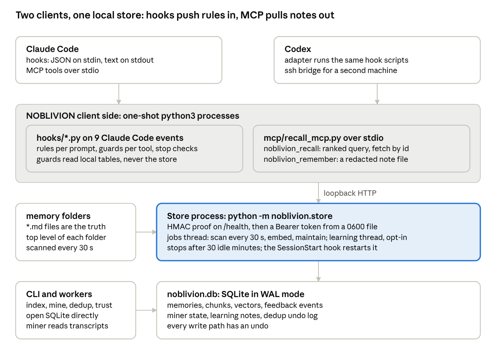

<!-- SPDX-License-Identifier: AGPL-3.0-or-later -->

# NOBLIVION: executive summary

NOBLIVION is a free, open-source plugin that gives Claude Code and Codex one shared, searchable memory on your own machine. It finds the right project notes and rules at the right moment, warns or blocks when a tool call would break a rule, and keeps all data local by default.

## What it is

AI coding assistants forget. Each session starts with an empty context, and what the team learned yesterday has to be found again today. Claude Code has a built-in memory: Markdown notes that Claude reads at the start of a session and writes when it decides a fact is worth keeping. NOBLIVION builds on that memory. It does not replace it.

Your Markdown notes stay the source of truth. NOBLIVION adds a local index on top of them (a SQLite database and a small background process that listens only on the local machine) and a set of hooks. A hook is a small program that Claude Code runs at a fixed moment, such as when you send a prompt, before a tool call, or when a command fails. The hooks use the index to put the right note in front of the assistant at the right time.

## Why it exists

A note that the assistant does not read at the right moment has no effect. The built-in memory leaves five gaps:

- The memory index is loaded once per session, and only its first 200 lines or 25 KB. The rest is not loaded.
- No relevance ranking is documented. Claude opens a topic file only if it decides to.
- The instructions in `CLAUDE.md` are guidance. Nothing enforces them.
- After `/clear` or `/compact`, anything told to the assistant only in chat is lost.
- Memory is one folder per project. There is no shared memory for several projects, for a second assistant, or for a team.

NOBLIVION exists to close these gaps while keeping the notes in plain files that people can read, edit and version.

## Defects in Claude Code memory that NOBLIVION addresses

Source for the left column: the public Claude Code documentation.

| Gap in Claude Code memory | What NOBLIVION does |
| --- | --- |
| Only the first 200 lines or 25 KB of the index load at session start | Searches all notes and adds the best matches to every prompt, within a size cap |
| No ranking: Claude opens a note only by choice | Ranks notes with keyword search and meaning-based (vector) search, then shows the best ones with a short "apply" line |
| Rules are advice, not enforced | Guards read rules from your notes. Before a tool call they show the matching rule. A rule can also block the command, with a reasoned override |
| Nothing is recalled when a command fails | Error recall looks for notes that quote the error and shows them |
| Chat-only instructions are lost on `/clear` and `/compact` | Continuity saves the rules that were shown before a compaction and prints them again afterwards. An optional briefing opens each session |
| A subagent does not get the main session's memory | Injects the matching rules when a subagent starts |
| One folder per project, one assistant | One store for many projects. Claude Code and Codex use the same notes |
| Duplicate and stale notes are merged by hand | A duplicate sweep finds notes that say the same thing, with undo. A usage report lists notes to retire, promote or demote |
| Notes are written only when Claude decides to write them | Optional background learning turns new conversations into scoped memories. An explicit save tool writes reviewed notes |

## Features

**Recall**
- Automatic recall on every prompt, with a score floor and a size cap.
- On-request recall with the `noblivion_recall` tool: search, fetch one note by ID, or read one section.
- Save a reviewed note with the `noblivion_remember` tool. Secrets are removed before saving. A new note can name the older notes it replaces.
- Error recall after a failed shell command.
- Rules for subagents at the moment they start.

**Control**
- Guards that show or block, based on rules in your notes.
- Stop checks that can ask the assistant to finish open work before it ends a turn. They log only, by default, so you can see their effect first.
- A credential guard that blocks commands that would print a git URL with a password or token. Claude Code has no such guard.

**Care of the memory**
- Automatic re-index right after a note is written.
- A frontmatter check for note fields.
- A duplicate sweep with byte-for-byte undo.
- A usage report that records when a note is shown, used or contradicted.
- Import of memories from a JSONL file, with a dry run first and removal of what an import added.

**Reach**
- One local store for several projects.
- A Codex adapter that shares the same notes and the same hook scripts.
- An SSH bridge so a second machine can reach the store.

## How it works

- **Push.** Hooks add ranked notes to the prompt, matching rules to a tool call, and a briefing at session start. The assistant does not have to ask.
- **Pull.** Two tools let the assistant or the user search and save notes on request.
- **Store.** One background process per user serves the index on `127.0.0.1`. It proves itself to each client and requires a protected token. It stops after 30 idle minutes.
- **Files first.** The store is an index that can be rebuilt from the notes at any time. Every write has an undo.

## Privacy and safety

- Notes, database, vectors and usage data stay on your machine.
- With default settings the store makes no network connection after install.
- Two features can send note text to a hosted service: remote embeddings and the duplicate sweep. Both are off until you set them up and give consent in writing. Before text leaves the machine, NOBLIVION removes secrets and replaces paths, user names and IP addresses. It does not catch every name in plain prose.
- The store serves one operating-system user.

## What it does not do

- It does not run a network server.
- It does not sync notes between machines. Use any file tool for that.
- It does not change how Claude Code loads `CLAUDE.md` or `MEMORY.md`.
- It does not raise a client's compute or usage allowance.
- It does not support Windows.

## Off by default

These features exist and stay off until you turn them on: background learning, the duplicate sweep, remote embeddings, the session briefing and continuity after compaction. Stop checks and trust ranking ship in shadow mode: they record what they would do and change nothing. The maintainers run both switched on (stop checks in `enforce` mode, trust ranking `on`). To switch on, see [configuration](configuration.md).

## Install

You need Claude Code, `python3` 3.9 or newer, and [uv](https://docs.astral.sh/uv/).

1. Add the marketplace: `claude plugin marketplace add https://github.com/Noetic-os/NOBLIVION.git`
2. Install the plugin: `claude plugin install noblivion@noblivion`
3. Start a new Claude Code session and type `/noblivion:setup`. Allow the one install command it runs.

Recall works from the next prompt. Full steps: [install.md](install.md). Details on each feature: [README](../README.md), [how recall works](how-recall-works.md), [guards](guards.md), [learning](learning.md), [trust](trust.md), [privacy](dedup-and-privacy.md).

Licence: AGPL-3.0-or-later. Current release: 0.1.21 (early release, 0.1.x).
