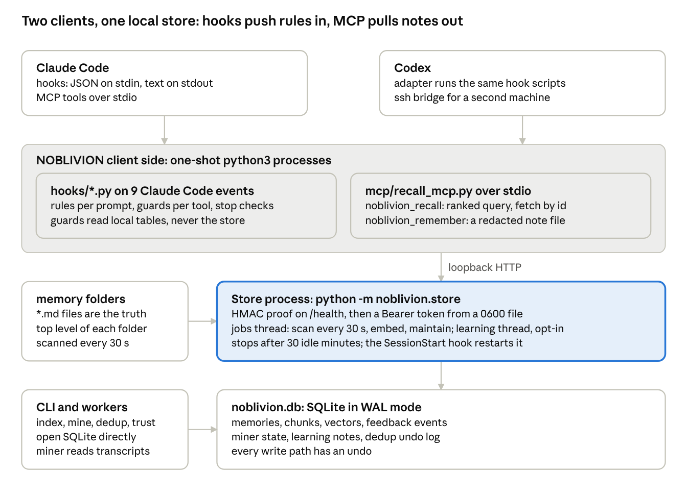

<!-- SPDX-License-Identifier: AGPL-3.0-or-later -->

# NOBLIVION against Claude Code memory

Written 2026-10-15 against NOBLIVION 0.1.15.

## Verdict

NOBLIVION is a complete, guarded retrieval and enforcement layer on top of the Claude Code memory files. It adds what the built-in memory does not have: ranked rules on every prompt, guards with deny at every tool call, error recall, one store for ten project roots, a second client, and continuity across clear, resume and compaction. The files stay the source of truth, every write has an undo, and nothing leaves the machine without typed consent. The mechanism and the safety run live today.

The value on real work is not proven. Every precision number comes from a fixture that is not held out. On real prompts the use rate is 0.7 percent. Trust ranking shows no gain and stays in shadow. The learning loop has produced one active note. Mined notes miss their own precision gate and stay out of the prompt.

Score: NOBLIVION 42 of 65, Claude Code built-in memory 22 of 65. NOBLIVION leads on 10 of 13 rows, ties on privacy, and loses on operation burden and context cost. It reaches 5 on no row, because no row is proven on real work.

Score scale, the same for both products:

- 0 = absent
- 1 = by hand only
- 2 = partial: off by default, in shadow, or held back by its own gate
- 3 = on and working
- 4 = on, working, and guarded by caps, undo or consent
- 5 = as 4, and proven on real work

For the two burden rows at the end, 5 means no burden and 0 means it blocks work.

| # | Dimension | Claude Code memory | NOBLIVION | Why |
| --- | --- | --- | --- | --- |
| 1 | Rules at the right moment, on every prompt | 1 | 4 | Built-in loads the index once per session, and Claude opens a topic file by choice. NOBLIVION ranks notes on every prompt under a score floor and a character cap; the use rate on real work is unproven. |
| 2 | Continuity across clear, resume and compact | 2 | 3 | Built-in reloads files from disk and loses chat context. NOBLIVION briefs at session start and restores the shown rules after compaction, but the briefing is off by default. |
| 3 | Guards at tool calls, with deny | 0 | 4 | Built-in has hooks but no memory-driven rules. NOBLIVION shows rule rows before a tool call, blocks a command that matches a rule, and takes a reasoned override; prevented faults are not counted. |
| 4 | Error recall after a failed command | 0 | 4 | None built in. NOBLIVION shows notes that quote the error, capped per session; use on real errors is not measured. |
| 5 | Rules for subagents | 1 | 3 | Built-in gives memory only to a fork. NOBLIVION injects rules at SubagentStart, but Claude Code passes no task prompt, so the hook falls back to meta files or the transcript. |
| 6 | Pull tools: recall and remember | 2 | 4 | Built-in: the Read tool on files, and Claude writes files itself. NOBLIVION: ranked query, fetch by id, section view, and a redacted remember that never edits the index file. |
| 7 | One store for many projects, a second client | 1 | 4 | Built-in: one folder per project. NOBLIVION: ten roots in one store, import, a Codex adapter and an ssh bridge; the gain for Codex is not measured. |
| 8 | Learning from transcripts | 0 | 2 | None built in. NOBLIVION mines corrections and tool errors and runs a learning loop, but mined notes miss the precision gate and stay out of the prompt, and the loop yields little. |
| 9 | Trust and stop checks | 0 | 2 | None built in. NOBLIVION computes a trust score per note and five stop checks, but both run in shadow because the measured gain is nil. |
| 10 | Hygiene: dedup, re-index, frontmatter | 1 | 4 | Built-in: the docs ask Claude to merge index lines by hand. NOBLIVION: dedup with consent and byte-for-byte undo, re-index right after a write, a frontmatter check. |
| 11 | Privacy | 4 | 4 | Both stay on the machine. NOBLIVION adds a loopback store with an HMAC proof and a protected token; its two network features need consent; its scrub misses host and company names. |
| 12 | Operation burden | 5 | 2 | Built-in: nothing to install. NOBLIVION: an install script and a model download, a hand rebuild after each update, Codex updated by hand, a store that stops when idle. |
| 13 | Context cost per prompt | 5 | 2 | Built-in: the index once per session. NOBLIVION: ranked rows plus label rows on every prompt up to a cap, re-sent on every later turn; not measured on real prompts. |
|  | Total | 22 | 42 |  |

Reading the table:

- Rows 1 to 7 and 10 lack only proof on real work to reach 5. That proof is the whole remaining distance.
- Rows 8 and 9 are the parts that do not work yet: learning yields little, and trust has shown no gain.
- Rows 12 and 13 are the price. Both are bounded by caps, and neither is measured on real prompts.

## What Claude Code memory does today

Claude Code's built-in memory is a folder of markdown files per project. It loads the first 200 lines or 25 KB of the index file `MEMORY.md` at every session start, and Claude reads the other files with its file tools when it decides a task relates to them. The documentation describes no search index, no ranking, no deduplication, no decay and no recall across projects. Facts below come from the Claude Code documentation at code.claude.com, read 2026-10-15.

| Element | What it does | Limit the docs state | Source |
| --- | --- | --- | --- |
| Auto memory folder | `~/.claude/projects/<project>/memory/`, one file per memory, `MEMORY.md` as the index; all worktrees of one repository share it | Machine-local; no sync between machines or to the cloud | [memory](https://code.claude.com/docs/en/memory) |
| Load at session start | The first 200 lines or 25 KB of `MEMORY.md`, whichever comes first | The rest is not loaded; over the cap Claude must rewrite the index | [memory](https://code.claude.com/docs/en/memory) |
| Recall during a session | Claude reads a topic file when the task relates to it, and shows "Recalled N memories" | No documented relevance ranking, embedding or index | [memory](https://code.claude.com/docs/en/memory), [claude-directory](https://code.claude.com/docs/en/claude-directory) |
| Writing a memory | Claude writes when a note helps a later session; "remember that ..." saves to auto memory | The trigger rules are not documented | [memory](https://code.claude.com/docs/en/memory) |
| Memory types | Frontmatter `type`: user, feedback, project, reference; a `modified` timestamp since version 2.1.214 | `name` and `description` fields are not documented | [memory](https://code.claude.com/docs/en/memory) |
| CLAUDE.md | Managed, user, project and local files joined in that order; `.claude/rules/*.md`; `@path` imports up to 4 hops | Guidance, not enforced; target under 200 lines; imports load at launch and cost context | [memory](https://code.claude.com/docs/en/memory) |
| Scope | Per project directory; `autoMemoryDirectory` moves the folder; `CLAUDE_CODE_PROJECT_DIR_NAME` lets projects share one folder on one machine | No team or cloud memory feature documented | [memory](https://code.claude.com/docs/en/memory) |
| Subagents | A subagent does not get the main session's auto memory, except a fork | No documented way to pass it | [sub-agents](https://code.claude.com/docs/en/sub-agents) |
| Controls | `/memory` toggles `autoMemoryEnabled`; `CLAUDE_CODE_DISABLE_AUTO_MEMORY=1` disables it | The toggle cannot enable it in background sessions | [env-vars](https://code.claude.com/docs/en/env-vars) |
| `/clear` and `/compact` | Both start from empty or summarised context; CLAUDE.md, rules and auto memory reload from disk | Instructions given only in chat are lost | [context-window](https://code.claude.com/docs/en/context-window), [commands](https://code.claude.com/docs/en/commands) |
| Hooks as the door for plugins | 33 hook events; `additionalContext` injects text as a system reminder on SessionStart, UserPromptSubmit, PreToolUse, PostToolUse and Stop | 10,000 characters per injected string; larger output goes to a file with a 2,000-character preview | [hooks](https://code.claude.com/docs/en/hooks) |

Open question: the hooks and MCP (Model Context Protocol) pages were read in part only, so the list of events that accept `additionalContext` may be incomplete.

## Architecture

NOBLIVION has four layers, each its own process or file: two clients (Claude Code and Codex), one-shot client-side scripts (the hooks and an MCP server), one long-running store process per OS user, and one SQLite file. The memory files stay the source of truth. The store holds a derived index that can be rebuilt from the files at any time.

Claude Code and Codex start the same one-shot scripts. Only the recall paths call the store, over loopback HTTP. Guards, stop checks and the CLI work on local files or open the database directly. The memory folders are the truth; the store and the database are an index that can be rebuilt.

### Process model

- A hook is a one-shot python3 process. Claude Code starts one per event, writes JSON on its stdin and reads its stdout. Each hook has a time budget from hooks.json.
- Guards, stop checks, label rows and the session line never call the store. They read local guard tables, one JSON file per project, rebuilt at session start.
- The MCP server lives for the length of a session and speaks JSON-RPC over stdio. It imports the recall hook for the HTTP call and the rendering, so both channels rank and print the same way.
- The store is one process per OS user. The SessionStart hook starts it detached and waits a few seconds. A file lock lets only one run; a second exits at once. It serves HTTP on 127.0.0.1 on a port chosen at start, proves itself to each client with an HMAC answer on a nonce, then requires a Bearer token from a protected file. A jobs thread scans the memory folders, embeds new rows and runs maintenance; an optional learning thread runs only when learning is configured. The store exits after 30 idle minutes.
- The CLI (index, mine, dedup, trust, learning) and the detached workers open SQLite directly, serialised by file locks. They do not need the store to run.

### Channels

- Push: hooks inject ranked rules into the prompt, guard rows into a tool call, and a briefing at session start. The model does not have to ask.
- Pull: the two MCP tools. noblivion_recall takes a query or a fetch id and returns ranked notes, a chunk or a section. noblivion_remember writes a redacted reference note into the session's memory folder and triggers a sync.
- Codex: an adapter runs the same hook scripts per Codex event against the same store and files. A remote bridge over ssh reaches a gateway on a second machine, stdio only, and never contributes captures from the remote side.

### Storage

- One SQLite file in WAL mode. Six migrations define: memories (source type, labels, weight, archive and delete flags, index text), chunks and chunk vectors (chunk 0 is a summary), whole-memory vectors, feedback events and the trust rollup, dedup actions and vetoes (the undo log), miner state (a byte offset per transcript), and the learning tables (notes, revisions, evidence, claims, drafts, jobs, budget).
- Indexing covers the top-level markdown files of every memory folder and of the learning scope folders. MEMORY.md is indexed as a category index and dropped by hygiene. Transcripts are never indexed directly; only the miner's rows are.
- Every write path has an undo: dedup moves the loser to an archive folder and can restore it byte for byte; import can remove what it added; a deleted note keeps a grace period.

### Ranking

- The store scores each chunk with BM25 (index text counted twice) and cosine similarity weighted by the note's weight, fuses the two with reciprocal rank fusion, adds a label boost, and collapses to one hit per file. Without a model it falls back to keywords only.
- The hook asks for a wide candidate set, re-ranks locally, applies the score floor only when the shipped model is in use, caps each row and the whole block, dedupes against the rows already shown this session, and prints an APPLY line whose length falls with rank.
- Trust is computed and logged for every row and does not reorder. The store never reorders either.

### Event flow

| Claude Code event | NOBLIVION hooks | What happens | Calls the store |
| --- | --- | --- | --- |
| SessionStart | store_client, guard_table, continuity_hook, trust_session_line, version_check, learning capture and summary | Starts the store if it is not running; rebuilds the guard tables; prints the briefing and the trust line; checks the plugin version | Yes: start, guard tables |
| UserPromptSubmit | recall_hook (with label rows), stop_checks mark, learning_context, learning_capture | Ranks notes for the prompt within its time budget; adds label rows for files, tools and tickets named in the prompt; marks a correction | Yes: recall |
| PreToolUse | guard_hook on Bash, Read, Grep, Edit and Write; mcp_session_hook; subagent_rules_hook | Shows rule rows; denies a command that matches a rule; blocks a credential print; binds a recall call to the session | Guards no; subagent rules yes |
| PostToolUse | memory_fields_hook, memory_sync_hook, error_recall_hook, learning_capture | Checks frontmatter of a written memory file; re-indexes after a memory write; shows notes that quote a failed command | No: sync runs the CLI; error recall is local by default |
| PostToolUseFailure | error_recall_hook, guard_hook | Error recall; records evidence for a guard override | No |
| PreCompact | continuity_hook | Saves the shown set and prints the rules again, so they survive compaction | No |
| SubagentStart | subagent_rules_hook | Injects the rules that match the subagent's task | Yes |
| Stop | stop_checks, trust_flush | Runs the stop checks in shadow; flushes the session's feedback events in batches | Yes: flush |
| SessionEnd | learning_capture | Writes the learning capture record (the transcript miner hook was removed in 0.1.19, NOBLIVION-154) | No: direct SQLite |

## Design choices

Every choice below trades a capability for locality, reversibility or safety. The table names the choice, why it was made, and what it costs.

| Choice | Why | What it costs |
| --- | --- | --- |
| The memory files stay the truth; the store is a derived index | A person can read, edit or delete a note with any editor, and the index can be rebuilt from the files at any time | A scan loop and a sync hook; the index can lag a write by a few seconds |
| One SQLite file and one local process; no server, no account | Zero setup beyond the install script; no network after install; one OS user owns the data | One store per user and machine; no sync between machines; the store stops when idle and must restart |
| A small local embedding model | Zero cost per query, and no prompt text leaves the machine | A model download at install; English-only recall; weaker than a hosted model |
| Hooks for push, MCP for pull | Rules reach the prompt and the tool call without the model asking; the model can still search and save by choice | One new process per event, each with a time budget; Claude Code caps hook output |
| Guards read local tables, never the store | A guard must answer in milliseconds and must not fail when the store is down | The tables are rebuilt at session start, so a new rule waits for the next session |
| Every write path has an undo | Dedup, archive and import can be reverted byte for byte, so automation may touch the files | An undo log and archive folders that grow |
| Learning accepts only a zero-cost local model | No bill can grow unseen; the two paid features need typed consent | Learning quality is bound to the local model; the loop has yielded little so far |
| Trust ranking and stop checks ship in shadow until a gate passes | A feature that reorders or blocks must first show a measured gain on enough trials | Both run and log but change nothing yet |
| Ranking fuses keywords and meaning, one hit per file, a score floor | Keyword and meaning both count, and a prompt with no matching note gets nothing | The floor is tuned on a fixture; a note that matches only by rule words can fall under it |
| Mined notes stay out of the prompt until a precision gate passes | Transcript mining is noisy, and a wrong rule in every prompt costs more than a missed one | Mined knowledge reaches the model only through the recall tool with an explicit flag |

The design reaches its own goals: locality, reversibility and safety hold in the code and in the live store. What it has not reached is measured value on real work; see Evidence and Gaps and risks.

## Feature inventory, and where it separates from Claude Code

NOBLIVION adds 21 capabilities on top of the memory files, and changes none of what Claude Code does with them: it never edits `MEMORY.md`, and it does not change how Claude Code loads `CLAUDE.md` or `MEMORY.md` (README line 50). The separation is in six places: ranked recall on every prompt, enforcement at the tool call, a learning loop, trust scores, deduplication with undo, and one store for many projects and a second client. Versions are from `CHANGELOG.md`; paths are inside the 0.1.15 plugin folder.

| Feature | What NOBLIVION does | Claude Code built-in | Since, file |
| --- | --- | --- | --- |
| Session-start briefing | Up to 2 DECISION, 2 OPEN and 1 TRAP rows, at most 1,500 characters; skips files that `MEMORY.md` already links; off by default (`NOBLIVION_CONTINUITY`) | Loads the first 200 lines or 25 KB of `MEMORY.md`, nothing else | 0.1.0, `hooks/continuity_hook.py` |
| Ranked rules on every prompt | Embeds the prompt with BAAI/bge-small-en-v1.5, keeps rows above cosine 0.68, injects up to 30 rows and 9,000 characters with an APPLY line each; re-rank, hygiene, row dedupe; since 0.1.15 keyword weight for rule, apply and trigger words, label boost and section chunks | None; Claude reads a topic file when it decides the task relates | 0.1.0, floor 0.1.6; `hooks/recall_hook.py`, `src/noblivion/ranking.py` |
| Prompt label rows | Up to 3 rows for notes that name a file, tool, ticket or service found in the prompt | None | `hooks/label_rows.py` |
| Tool-call guard rows and deny | Before Bash, Read, Grep, Edit and Write: shows up to 3 rule rows; a `violates:` regex blocks a Bash command; `# guard-ok: <reason>` overrides; stamp check about 0.3 ms | PreToolUse hooks exist, but no memory-driven rules; CLAUDE.md is guidance only | 0.1.0, per-project tables 0.1.3; `hooks/guard_hook.py`, `docs/guards.md` |
| Credential guard | Blocks a command that would print a git URL that holds a credential | None | `hooks/credential_guard.py` |
| Error recall | After a failed Bash call, shows up to 2 notes that quote 3 words in a row from the error; mined `tool_error` notes join in 0.1.15 | None | `hooks/error_recall_hook.py` |
| Subagent rules | Up to 8 rules, 2,500 characters, injected at SubagentStart | A subagent gets no auto memory, except a fork | `hooks/subagent_rules_hook.py` |
| `noblivion_recall` MCP tool | Query, `fetch_id`, `chunk`, `section`, `include_mined`; k 1 to 20; a note over 6,000 characters opens as summary plus section list; bound to the session since 0.1.15 | The Read tool on memory files | 0.1.0; `mcp/recall_mcp.py` |
| `noblivion_remember` MCP tool | Writes a redacted `reference_<client>_<hash>.md` into the session's memory folder; never touches `MEMORY.md` | Claude writes memory files itself | 0.1.3; `mcp/recall_mcp.py` |
| Transcript miner | At session end, mines correction, `tool_error` and review notes into the database only, with prior trust 0.3; off by default since 0.1.6; its hook and command were removed in 0.1.19 (NOBLIVION-154) | None | 0.1.0; `src/noblivion/miner.py` remains as a library |
| Learning and consolidation | Opt-in; accepts only a zero-cost local model; writes `learned-<uuid>.md` files, evidence-linked claims and inert procedure drafts; jobs under a daily budget | None | 0.1.11, consolidation 0.1.14; `docs/learning.md` |
| Dedup with consent | Pairs above cosine 0.75 go to a hosted judge after typed consent; apply and undo byte for byte; `sweep` with a 0.5 USD daily cap | None; the docs ask Claude to merge index lines by hand | 0.1.0, sweep 0.1.15; `src/noblivion/dedup.py` |
| Trust ranking | A trust score per note from recall, use and contradiction events; report with retire, promote and demote; ranking off or shadow until n is at least 30 and the Wilson lower bound is at least 0.70 | None; a `modified` timestamp only | 0.1.0; `src/noblivion/trust.py`, `docs/trust.md` |
| Continuity across `/clear`, resume and compact | SessionStart matcher `startup, resume, clear, compact` runs the briefing; PreCompact saves the shown rules and shows them again after compaction | CLAUDE.md and auto memory reload from disk; chat-only context is lost | 0.1.0; `hooks/hooks.json` |
| memory_sync | Re-indexes 3 seconds after a memory `*.md` write or a Bash change in the folder; a fields hook warns on bad frontmatter | Not needed: the files are the store | 0.1.0; `hooks/memory_sync_hook.py` |
| Stop checks | Commit, tests, notify, deploy and lesson checks at Stop; shadow mode and `stop report` | Stop hooks exist, no built-in checks | 0.1.0, shadow 0.1.3; `hooks/stop_checks.py` |
| One store for many projects, and import | One SQLite store indexes every `~/.claude/projects/*/memory` folder plus a global folder; JSONL import with `--remove` | One folder per project; sharing only through `CLAUDE_CODE_PROJECT_DIR_NAME` | 0.1.3, import 0.1.8; `src/noblivion/importer.py` |
| Codex adapter | A second client on the same store and files, with a remote bridge and gateway for a second machine | None | 0.1.3; `codex/adapter.py`, `scripts/install_codex.py` |
| Privacy | Store on 127.0.0.1 with an HMAC proof and a 0600 token; data folder 0700; no network after install except two consented features (remote embeddings, dedup judge), both with redaction | Local files, no network | `README.md` Privacy, `docs/dedup-and-privacy.md` |
| Install and update | Marketplace plugin; `/noblivion:setup` runs `install.sh` (uv, Python 3.11 or later, a 70 MB model); version-free MCP launcher for SSH clients; `/reload-plugins` notice after an update | Built in, nothing to install | 0.1.2, launcher 0.1.13; `scripts/` |
| CLI | `index`, `consent`, `dedup`, `trust`, `stop report`, `serve`, `ensure-running`, `mine`, `import`, `migrate-from-legacy`, `learning ...` | `/memory`, `/init` | `src/noblivion/__main__.py` |

## Evidence from this host

The live store holds 5,278 memories and logged 7,985 recall events in six days, but only 55 of those recalls were marked as used (0.7 percent), and the learning loop produced 1 note from 470 jobs. Measured 2026-10-15 on the test host, from the plugin data folder and a copy of `noblivion.db`.

| Measure | Value | Where measured |
| --- | --- | --- |
| Plugin version | 0.1.15 on the store, the venv and all 4 Claude Code MCP servers | `installed_plugins.json`, process list |
| Codex clients | configured for 0.1.15 today; the 2 running sessions stay on 0.1.12 until restart | the Codex config file, process list |
| Store database | `noblivion.db`, 58 MB, created 2026-10-08 | data folder |
| Embedding model | BAAI/bge-small-en-v1.5, 384 dimensions, fastembed backend, local | `meta` table |
| Memories indexed | 5,278 live rows: 4,201 from Claude Code memory markdown files, 1,074 mined from transcripts; 3,692 of them imported from an earlier export; 3,051 archived | `memories` table |
| Chunks and vectors | 10,141 chunks, 5,281 chunk vectors, 2,229 whole-memory vectors | `memory_chunks`, `chunk_vectors`, `vectors` |
| Categories | reference 3,138; feedback 1,228; project 454; tool_error 410; correction 21; user 6 | `memories.category` |
| Project roots | 10 roots share one store, keyed by project and root | `memories.root` |
| Recall feedback | 7,985 recall, 55 use, 16 contradiction events, 2026-10-09 to 2026-10-14 | `feedback_events` |
| Trust scores | mean 0.50, range 0.20 to 0.64, over 57 trials | `feedback` table |
| Tool-call guard rows | 1,753 PreToolUse decisions logged; 155 error-recall events | `guard-log.jsonl`, `error-recall-log.jsonl` |
| Transcript miner | 846 transcripts tracked; the session-end hook said "on" 8 of 8 times since the fix | `miner_state`, `cache/mine-hook.log` |
| Learning jobs | 470 jobs: 8 done, 322 exhausted, 140 pending; 1 active note | `learning_jobs`, `learning_notes` |
| Dedup | consent recorded 2026-10-14; 2 actions, 0 vetoes | `meta`, `dedup_actions` |
| Trust ranking | shadow mode: it logs what it would reorder, and does not reorder | `config.json` |
| Injection caps | 30 candidates, 9,000 characters injected at most, 2,000 query characters | `config.json` |
| Learning provider | local model `qwen3.8:27b-64k` over a local endpoint, budget 100 calls per day, cost 0 | `learning.json` |

One stale value remains: `learning-client.json` in the data folder still names the 0.1.12 release as `repo_root`. It is harmless, because `hooks/learning_capture.py` line 30 overwrites `repo_root` with the running plugin root on every call.

### Numbers the repository documents

Every precision figure comes from a made-up fixture; the only real-session figures are the trust numbers, and they sit under their own gate.

| Measurement | Result | Source |
| --- | --- | --- |
| Recall at the 0.68 floor, fixture of 36 notes and 57 prompts (20 with no matching note) | precision 0.857, recall 0.750; with no floor 0.023 and 1.000 | `docs/how-recall-works.md` lines 198 to 212 |
| Error recall | store mode, floor 0.70: 1.000 and 0.857; local mode, floor 0.39: 1.000 and 0.643 | same |
| Dedup at cosine 0.75 | 1.000 and 1.000 on 8 duplicate pairs of 276; the best non-duplicate scored 0.726 | same |
| CI gates | recall, index, subagent 0.80 and 0.70; error store 0.90 and 0.78; dedup 0.85 and 0.85 | `tools/eval/thresholds.json` |
| Trust on real sessions | 521 sessions over 53 days, 766 notes, 40,899 shows, 143 citation uses, 0 contradicts; citation precision 15 of 29, Wilson lower bound 0.344, against a default-on bar of 0.70 | `docs/trust.md` |
| Trust time split | mean reciprocal rank 0.447 with trust off and with trust on: no gain | `docs/trust.md` |
| Miner usefulness, 0.1.15 sample | under 0.70 of 30 shows of correction notes were useful, so mined notes stay out of the prompt index | `CHANGELOG.md` 0.1.15 |
| Miner precision sample, NOBLIVION-105 | strict 0.27, lenient 0.47, gate 0.70; one hub row showed in 14 of 30 cases | NOBLIVION-105 ticket comment, 2026-10-14 |
| Hook speed, NOBLIVION-110 | median hook time 162 ms before and 50 ms after, on a 1,000-file fixture | session handoff 2026-10-14 |
| Learning held-out fixture | baseline kept 12 of 40 particulars, changed code 40 of 40; 13 model calls against 74 | `docs/evidence/noblivion-101-heldout.md` |
| Hook time budgets | recall 2 s, prompt embedding 1 s, error recall 0.8 s, guard check 1.5 s; guard stamp check about 0.3 ms at 200 notes; 650 rules build in about 7 s and rebuild in 0.2 s | `docs/guards.md`, `CHANGELOG.md` |
| Store idle stop | 30 minutes; 11 of 164 prompts lost recall in one week before the 2 s wait added in 0.1.10 | `CHANGELOG.md` |
| Tests and CI | 107 test files, 2,341 test functions (counted); CI on Ubuntu with Python 3.10 and 3.12, macOS with 3.12, Python 3.9 in part, one real-model job behind the gate, lint, changelog and gitleaks checks | `tests/`, `.github/workflows/ci.yml` |

## Gaps and risks

NOBLIVION proves its mechanism, not yet its value. Every precision figure comes from a fixture, and the three signals from real work (use rate, citation precision, learning yield) all sit under their own gates. The open tickets below are in the NOBLIVION Jira project.

- Value on real work is unproven. 55 uses in 7,985 recalls; citation precision under the 0.70 bar that would switch trust ranking on; the time split shows no gain; 1 note from 470 learning jobs. The learning docs say the loop "does not establish productive real-user outcome causality".
- The evaluation fixture is not held out. The docs call its result "too good as a forecast". Not measured at all: live miner precision, label rows, long subagent task text, injection-filter coverage, index time on a quiet CPU, and any Codex gain.
- Context cost is bounded but not measured on real prompts. The caps allow 9,000 characters of ranked rows per prompt, 2,400 of label rows per prompt, 6,000 of guard rows and 6,000 of error recall per session. Every injected character is re-sent on every later turn. NOBLIVION-116 (index time and injected characters on replayed real prompts) is open.
- Mined notes stay out of the prompt. They reach only the `noblivion_recall` tool with `include_mined`. NOBLIVION-114 (hybrid mode for rule-word-only notes against the 0.68 floor) and NOBLIVION-117 (a prompt index for mined correction rows behind a 0.70 precision gate) are open. No command lists or removes mined notes. NOBLIVION-105 (miner live acceptance) waits for one mined row in `feedback_events` and for 117.
- It depends on Claude Code behaviour that is not under its control. `updatedInput` is applied only together with a `permissionDecision` of allow or ask. SubagentStart carries no task prompt, so the hook falls back to meta files, the transcript or a fifo. Hook output stops at 10,000 characters. Claude Code deletes the old plugin folder after 14 days, so SSH clients need the launcher. A running session needs `/reload-plugins` after an update (NOBLIVION-99). No hook sends the `target` parameter (NOBLIVION-115).
- Operation needs a hand after each update. The store must be rebuilt with `/noblivion:setup`; today the store ran 0.1.14 under plugin 0.1.15 until the setup script ran. Codex does not auto-update. The store stops after 30 idle minutes.
- Platform limits: no Windows; one OS user per store; no sync between machines; an English-only 384-dimension model, so non-English recall is worse; sub-folder files are not indexed; the scrub misses host and company names; the credential guard covers git URLs only and over-blocks `find | xargs`.
- The docs disagree in two places: model size 130 MB in the design document against 70 MB in the setup skill; a `doctor` command is named in `docs/codex.md` but is absent from the 0.1.15 command dispatcher.

## Conclusion

Target. NOBLIVION set out to give a coding agent a memory that is recalled at the right moment, enforced at the tool call, shared across projects and clients, and kept clean without hand work, while the files stay the truth and nothing leaves the machine.

Distance covered. The mechanism is built, on and guarded. It scores 42 of 65 against 22 of 65 for the built-in memory and leads on 10 of 13 rows (see the Verdict). Locality, consent and undo are in place and run live. Nothing it does is irreversible.

What remains. The distance from 42 to a proven system is evidence from real work, in three places:

1. Use on real prompts. The use rate is 0.7 percent, and every precision number is from a fixture that is not held out. NOBLIVION-116 (index time and injected characters on replayed real prompts) is the measurement.
2. Mined notes. They miss the precision gate and stay out of the prompt. NOBLIVION-105 (miner live acceptance) waits for one mined row in the feedback events; NOBLIVION-117 is the gated prompt index for mined correction rows.
3. Context cost. It is bounded by caps but not measured on real prompts. NOBLIVION-116 covers it too.

Trust ranking and stop checks stay in shadow until their own gate passes. That needs events and time, not a work item.

Recommendation. Keep NOBLIVION on. Keep trust and stop checks in shadow. Run the NOBLIVION-116 measurement within the week. Add no feature until the use rate moves or the measurement shows that the caps must come down.

In one sentence: against the Claude Code built-in memory, NOBLIVION is the stronger system by mechanism and by safety, and by a wide margin; it has not yet shown that the mechanism pays for its context cost on real work, and that proof is the next and only step.
