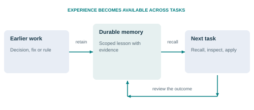
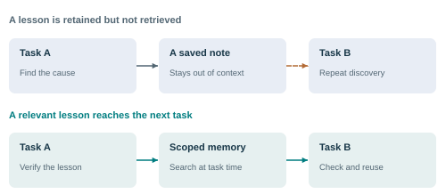
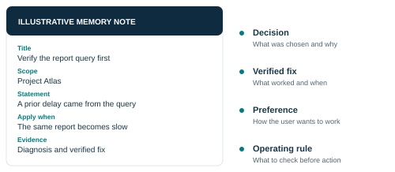
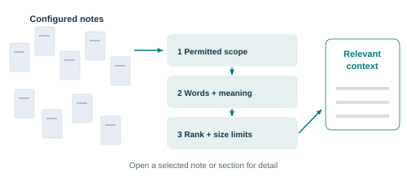
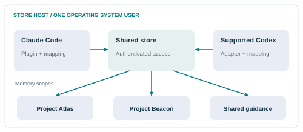

<!-- SPDX-License-Identifier: AGPL-3.0-or-later -->

# Noblivion executive whitepaper

## Persistent memory for AI coding assistants

**3 November 2026 | Version 0.1.21 | Early release**

[Read the illustrated PDF](noblivion-executive-whitepaper.pdf).

## 1 Make experience available to the next task

Noblivion gives compatible artificial intelligence (AI) coding assistants a shared, searchable memory built from readable notes. It brings relevant lessons and rules into the work as it happens.

*Figure 1. The purpose is continuity: a lesson from earlier work can inform a later decision.*

For leaders, the opportunity is to reduce repeated investigation, repeated corrections and avoidable mistakes. The mechanism is specific: retain useful knowledge, retrieve it in context and make selected rules actionable. These are expected benefits to test, not measured business outcomes promised by the product.

Noblivion is an early, open-source release for Claude Code and supported Codex setups. It complements the assistant and existing project instructions. It does not train the assistant's underlying model, replace its permissions or provide an enterprise knowledge platform out of the box.

This paper explains why the memory layer matters, what it contains, how information moves through it and which decisions remain with the organisation. The recommended starting point is a bounded pilot with named knowledge owners and clear measures of value.

Sources: [1](#source-1), [2](#source-2), [3](#source-3).

## 2 Useful knowledge must reach the moment of work

Keeping a note and using a note are different outcomes. A saved lesson has value only when the assistant finds the relevant part and applies it correctly.

*Figure 2. Illustrative workflow. The diagram shows where value could arise; it does not claim measured time savings.*

### The organisational problem

Teams accumulate decisions, operating constraints and fixes across tasks. Some remain in chat. Others enter project files but are hard to find at the right time. When people change assistants, open a new session or return to a project, they may have to restate the same context. The issue is the path from retained knowledge to present action.

### The product response

Noblivion searches a configured set of memory notes and supplies relevant material during work. It can also recall a known fix after an error and show a rule before a tool call. The assistant can request more detail rather than receive every note in full. This keeps retrieval tied to the current task and to a finite context budget.

### The executive implication

Treat memory quality as an operating practice. A larger collection is not automatically better. Outdated instructions can make the same error easier to repeat. Assign ownership, record evidence and review whether recalled material actually helps. The business objective is better decisions and less rework, not more stored text.

Sources: [2](#source-2), [4](#source-4), [5](#source-5).

## 3 A practical memory layer around the assistant

Noblivion combines human-readable notes, a local search index and integration points that put knowledge into the assistant's workflow.

*Figure 3. Illustrative note anatomy. Clear scope and evidence matter more than the volume of saved text.*

Human-maintained knowledge lives in Markdown files: plain text that people can read, edit and version. Noblivion indexes configured memory folders in a local database. Search combines words with meaning-based similarity when the local embedding capability is installed. Learned memories also have authoritative database records for claims, evidence and revisions. Their Markdown files are readable projections. Back up both files and database; rebuilding search from files does not recover all learned state.

Hooks are small programs that the assistant runs at named moments. They can add relevant notes to a prompt or bring a matching rule to a proposed action. A tool connection also lets the assistant search, open a note or explicitly save a reviewed lesson. Integration must be installed, enabled and correctly mapped to the project.

The primary use case is continuity for AI-assisted software work. It can hold project facts, decisions, proven fixes and working preferences. It is not a general document warehouse, a replacement for the source repository or a substitute for authoritative systems of record. Important claims should point back to their evidence.

For an executive sponsor, the useful unit is therefore a small, maintainable lesson with a clear purpose. An indiscriminate archive of conversations is a different asset and carries a different cost and risk.

Sources: [1](#source-1), [2](#source-2), [3](#source-3), [4](#source-4), [6](#source-6).

## 4 A conversation becomes memory through checks

Noblivion supports an explicit save route and an optional background learning route. Neither should be understood as the model permanently remembering everything it sees.

*Figure 4. Delivery, extraction, acceptance and recall are separate stages. Success at one stage does not prove success at the next.*

### Explicit memory

A person or assistant can submit a concise note through the save tool. The note can include a rule, an apply condition and supporting evidence. The save path applies safeguards and writes to the configured memory folder. Indexing then makes the note available for later retrieval. A newer note can explicitly identify older notes that it replaces.

### Optional background learning

When configured, eligible conversations are captured, scoped, processed and checked before an accepted memory is committed. The current worker accepts only a configured local model with an explicit zero-dollar provider price. It enforces finite call, token and time budgets. This avoids a hosted inference charge in that path; it does not remove hardware, energy or administration costs.

Unresolved context, conflicts or insufficient output can defer work. A source delivery receipt proves receipt, not a useful saved lesson. The organisation should verify the full path from eligible conversation to accepted note to correct recall.

Background learning is off by default. Reading existing memories and contributing new material are separate controls. The organisation must decide which projects and sessions may contribute, how retained material is managed and who reviews important corrections.

Sources: [3](#source-3), [4](#source-4), [6](#source-6).

## 5 Select relevant context before adding more detail

Recall narrows a collection of notes to a small set that may help the current task. The assistant can then open a selected note or section for the detail it needs.

*Figure 5. Conceptual recall path. A retrieved match is a candidate source, not proof that its advice is current or correct.*

The project mapping and memory-use controls determine the permitted scope. Search can match exact words and, with the embedding capability, related meaning. This matters when a current question uses different wording from an earlier lesson. Ranking and size limits control what reaches the prompt. The default prompt filter favours actionable notes with a rule and an apply condition; other notes remain searchable on request.

Noblivion can supply short index rows rather than whole files. The assistant can request the full note or a section when it needs evidence or detail. Error recall provides another entry point: a failed command can trigger a search for notes about that error. None of these paths guarantees that the best note exists or will be selected.

### A concrete example

A fictional team asks an assistant to investigate a slow report. A prior note says that the same symptom came from an inefficient query, records the diagnostic evidence and names when the fix applies. Recall can bring that note into the new task. The assistant still needs to check today's system before reusing yesterday's fix.

Optional trust ranking can adjust local prompt-index ordering using usage evidence. It is off by default and does not generally reorder ordinary search-tool results. Leaders should judge retrieval by relevance and verified outcomes, not by the existence of a ranking score.

Sources: [2](#source-2), [4](#source-4), [5](#source-5).

## 6 Bring selected rules to the point of action

A rule written in a file is guidance. A correctly configured guard can also inspect a proposed tool action and return a decision before that action runs.

*Figure 6. Controls operate at specific integration points. They do not replace the assistant's permissions or the operating system's security.*

Rules can state when they apply and what pattern constitutes a violation. For example, a fictional project may require a named validation step before a release command. A reminder can surface that requirement. Where a supported deny rule matches, the guard can block the command. The rule must be expressible and must match the action the integration actually sees.

This is a practical mechanism for repeatable operating constraints, not an understanding of every possible unsafe action. Ordinary action guards fail open on error. Ambiguous rules, timeouts, missing hooks and actions outside the covered path limit protection. Supported reasoned overrides are part of the design. Review overrides and false blocks as operational evidence.

Other checkpoints help work continue: error recall can retrieve a known fix after a command failure, and stop checks can ask the assistant to complete open work before ending a turn. Stop checks ship in shadow mode, which records what they would ask without blocking completion. Enforcement is an explicit operating choice.

The sponsor's task is to choose a small set of clear, high-value rules and assign a rule owner. Begin with observation, test realistic cases and inspect incorrect blocks before wider enforcement. Existing approval rules, access controls and human accountability still apply.

Sources: [2](#source-2), [7](#source-7).

## 7 One store with deliberate project boundaries

Compatible Claude Code and Codex integrations can use the same memory files and store. Sharing depends on explicit mapping and the capabilities of the client.

*Figure 7. A supported deployment pattern. A common store does not automatically create organisation-wide synchronisation or multi-user isolation.*

For direct sharing, the clients run on the same computer, as the same operating system user, with the same configured store and intended project scope. The Codex adapter translates supported events into the shared Noblivion code. A second host can use an explicitly configured Secure Shell (SSH) bridge, which carries the connection to the store host without exposing a new public store listener.

The current Codex setup requires tool and hook support. A client that exposes only a tool connection is not automatically equivalent to a complete native integration. Native reads can be bound to the current chat with short-lived, single-use capabilities, and the store rechecks memory-use controls at read time. Correct forwarding and compatible versions matter.

Project scope helps select the intended memory. Shared general guidance can also be included, so verify which roots each client searches. Scope is not a defence against a hostile process controlling the same user account. The product does not provide a multi-tenant enterprise identity system, a general team permissions console or automatic note synchronisation between machines.

For a pilot, choose one known client path and one well-defined project. Prove that a permitted chat can recall the intended note and that an opted-out chat cannot. Expand the deployment only after the actual client route has been verified.

Sources: [1](#source-1), [3](#source-3), [8](#source-8).

## 8 Map the full path of the information

Local memory storage is an important design choice. It does not mean every part of an AI-assisted workflow runs locally.

*Figure 8. Distinguish the memory service's data flows from the assistant's own model connection. Assess both.*

By default, Noblivion keeps its notes, index, vectors and trust records local. Its store listens on the local machine and uses protected authentication. An optional SSH bridge changes which host holds and processes the data, so that host becomes part of the deployment's data boundary.

Recalled text is supplied to the assistant's context. If that assistant uses a hosted model, the recalled text can follow the assistant's normal data path to that provider. Local retrieval therefore does not by itself establish end-to-end data residency. The organisation must assess the assistant service as well as Noblivion.

Two optional Noblivion paths can send text to hosted services: remote embeddings and model-based duplicate judging. They require configuration and consent. Redaction removes recognised secrets and masks specified identifying details before outbound text is sent, but it is not a guarantee that every sensitive name or statement will be caught. The current background learner uses a local provider.

Set policies for contribution, memory use, retention, backups and correction. Pausing new contribution does not automatically remove accepted memories or all retained source material. Review each data class and deletion path. These technical controls support governance; they are not, on their own, a compliance certification or a complete access-management system.

Sources: [1](#source-1), [3](#source-3), [6](#source-6), [8](#source-8), [9](#source-9).

## 9 Usage evidence helps review knowledge

Noblivion's trust value describes observed use. It is not a probability that a note is true, a certification or a substitute for checking facts.

*Figure 9. Exposure, use and correctness are different questions. A popular note can still be wrong or out of date.*

The system records events such as a note being shown, opened through the recall tool or involved in a guard decision. These events support a report of notes to review, promote, demote or retire. Merely displaying a note does not count as proof that it was used successfully. Several additional inferred signals, such as citation or behaviour matching, are optional and off by default.

When enabled, trust ranking makes a bounded adjustment to a supported recall ordering. It should not be sold as automatic truth discovery. Usage evidence can reflect repeated habits, an incomplete sample or an outdated practice. Changes to an important rule need a responsible owner and current source evidence.

### A useful review discipline

Ask whether the note still applies, whether its evidence can be checked and whether another note replaces it. Review repeated corrections and guard overrides. Remove redundant material carefully, preserve the evidence needed to understand a decision and validate the resulting recall. The optional duplicate sweep offers a separate maintenance route with documented undo for its changes.

No organisation-wide productivity, cost or reliability improvement is measured in this paper. Repository evaluations exercise specific technical behaviours; they do not establish a return on investment for a different organisation. The pilot must measure both useful recall and the cost of incorrect recall.

Sources: [5](#source-5), [9](#source-9), [10](#source-10).

## 10 Prove value in a bounded pilot

Start with a workflow where repeated context and repeated mistakes have a visible cost. Keep the scope small enough to inspect every important result.

*Figure 10. A proposed adoption sequence, not a product roadmap or a claim of achieved savings.*

Choose a recurring engineering workflow and a comparable baseline period. Name an executive sponsor, a technical owner and an owner for the notes and rules. Begin with a curated set of verified lessons and the minimum supported integration. Enable optional learning or enforcement only when its purpose, budgets and controls are clear.

Measure time spent restating context and resolving repeat incidents. Sample recalled notes for relevance and factual currency. Track useful accepted lessons, incorrect recalls, false guard blocks and overrides. Verify opt-outs on the actual client route. Compare similar tasks; do not treat more notes, more retrievals or a higher trust value as business value.

Build the business case from verified time saved and avoided rework, less review effort, integration work, local compute and any explicitly enabled provider costs. Set acceptance thresholds before the pilot. Stop or revise the approach if irrelevant memory, stale advice or control failures outweigh the benefit.

Technical leadership owns compatibility and operation. Security and privacy leaders own the data-flow review. Engineering leaders own the working rules and their exceptions. Finance validates the cost assumptions. Before expansion, assign ongoing maintenance and review the project's AGPL-3.0-or-later licence with the appropriate adviser.

The decision is whether a controlled memory layer improves this organisation's work. Expand on demonstrated outcomes, with known limits and accountable owners.

Sources: [1](#source-1), [3](#source-3), [6](#source-6), [7](#source-7), [9](#source-9), [10](#source-10).

## Source guide

This paper describes public source revision `f64472bfa247fc4cea9853076b4a187ecf393e90`. It is a source-based explanation, not a new operational test or a report of measured business gains. Examples and illustrations are explanatory. Product defaults differ from individual deployment settings.

1. [Product scope and supported platforms](https://github.com/Noetic-os/NOBLIVION/blob/f64472bfa247fc4cea9853076b4a187ecf393e90/README.md) - `README.md`.

2. [Local architecture and integration events](https://github.com/Noetic-os/NOBLIVION/blob/f64472bfa247fc4cea9853076b4a187ecf393e90/docs/design/0001-architecture.md) - `docs/design/0001-architecture.md`.

3. [Codex integration and per-chat read controls](https://github.com/Noetic-os/NOBLIVION/blob/f64472bfa247fc4cea9853076b4a187ecf393e90/docs/codex.md) - `docs/codex.md`.

4. [Indexing and recall selection](https://github.com/Noetic-os/NOBLIVION/blob/f64472bfa247fc4cea9853076b4a187ecf393e90/docs/how-recall-works.md) - `docs/how-recall-works.md`.

5. [Usage evidence and trust ranking](https://github.com/Noetic-os/NOBLIVION/blob/f64472bfa247fc4cea9853076b4a187ecf393e90/docs/trust.md) - `docs/trust.md`.

6. [Background learning and its controls](https://github.com/Noetic-os/NOBLIVION/blob/f64472bfa247fc4cea9853076b4a187ecf393e90/docs/learning.md) - `docs/learning.md`.

7. [Guards and stop checks](https://github.com/Noetic-os/NOBLIVION/blob/f64472bfa247fc4cea9853076b4a187ecf393e90/docs/guards.md) - `docs/guards.md`.

8. [Sharing memory between clients](https://github.com/Noetic-os/NOBLIVION/blob/f64472bfa247fc4cea9853076b4a187ecf393e90/docs/shared-memory.md) - `docs/shared-memory.md`.

9. [Duplicate maintenance and outbound privacy](https://github.com/Noetic-os/NOBLIVION/blob/f64472bfa247fc4cea9853076b4a187ecf393e90/docs/dedup-and-privacy.md) - `docs/dedup-and-privacy.md`.

10. [Evaluation scope and interpretation](https://github.com/Noetic-os/NOBLIVION/blob/f64472bfa247fc4cea9853076b4a187ecf393e90/docs/evaluation.md) - `docs/evaluation.md`.

11. [Configuration defaults](https://github.com/Noetic-os/NOBLIVION/blob/f64472bfa247fc4cea9853076b4a187ecf393e90/src/noblivion/config.py) - `src/noblivion/config.py`.

Solid arrows show an information or workflow path. Dashed arrows mark an optional path or a gap, as labelled. The diagrams are simplified and are not deployment specifications or performance measurements.

Learning and trust ranking default off. Stop checks default to shadow mode. Source code and the configuration reference take precedence over older summary wording. The learning and guard guides describe the relevant controls.

Licence: AGPL-3.0-or-later. This paper provides no legal or compliance determination.
